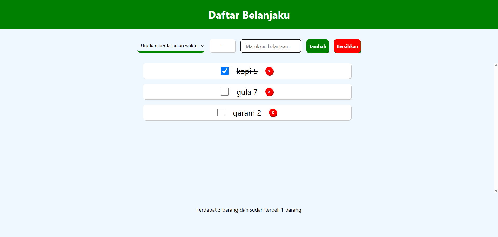

# Daftar Belanjaku

Sistem pencatatan belanja sederhana menggunakan React + Vite.
Project sebagai latihan saja.

# Fitur

1. Menambahkan barang
2. Menandai barang yang sudah dibeli
3. Menghapus barang
4. Sorting pada waktu, nama, dan barang yang sudah dibeli
5. Menampilkan status sesuai dengan kondisi barang.

# Install

Install dependencies: `pnpm install`

run: `pnpm run dev`

# Screenshots

